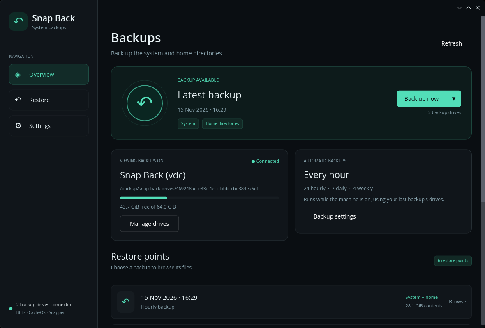
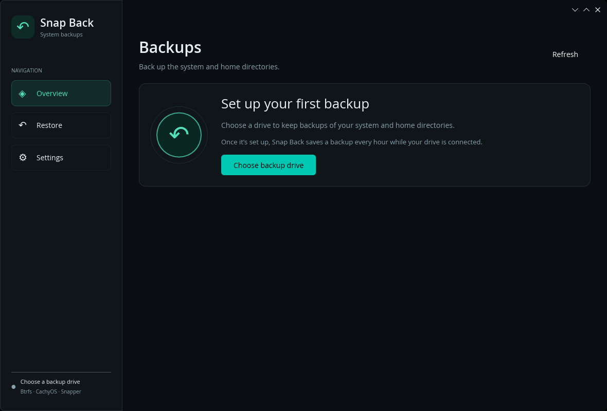
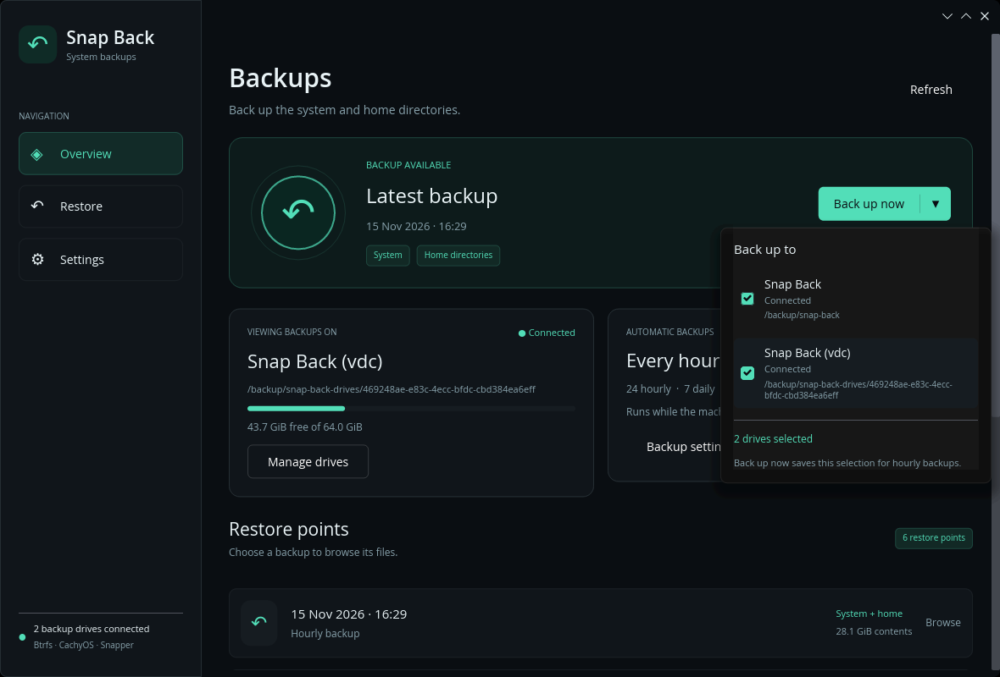
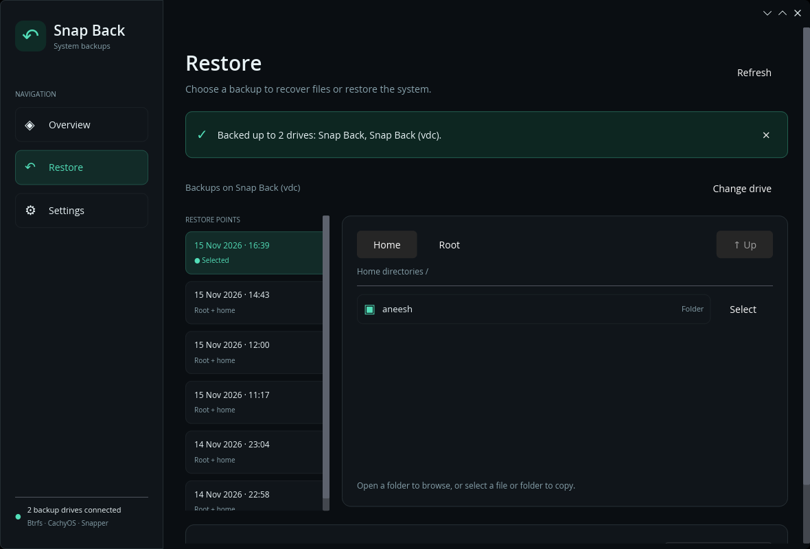

# Snap Back

[](https://github.com/aneeshthunga26/snap-back/actions/workflows/ci.yml)
[](https://github.com/aneeshthunga26/snap-back/releases/latest)

Snap Back backs up a CachyOS system and its home directories to another Btrfs drive. It uses Snapper for local snapshots and Btrfs send/receive to keep a separate copy you can restore from.

Pick your backup drives, click **Back up now**, and browse older versions when you need them.



This is an early prototype. Backup, file recovery, drive setup, and a full system restore have been tested in a CachyOS VM. It still needs testing on more hardware and disk layouts.

## What it does

- Backs up root, home, other configured system subvolumes, and boot files. Dotfiles and permissions are included.
- Sends a full backup first, then incremental changes. Completed restore points are read-only.
- Backs up to several drives in one run. Each drive keeps its own history and incremental parent. If one fails, the others are still attempted.
- Runs hourly while the machine is on, keeping 24 hourly, 7 daily, and 4 weekly restore points. Backups in the same time bucket are coalesced.
- Copies a file or folder out of a backup into a new directory, without overwriting an existing destination.
- Prepares a full system recovery and restores through a separate boot entry. The previous system volumes are kept for manual recovery.

The interface is written in Rust with [Iced](https://iced.rs/), [iced-shadcn](https://crates.io/crates/iced-shadcn), and [iced_anim](https://crates.io/crates/iced_anim). Desktop window controls follow the installed icon theme and button layout.

## Download and install

Get the Linux x86_64 tarball and `SHA256SUMS` from the [latest release](https://github.com/aneeshthunga26/snap-back/releases/latest). The release also includes the source and dependency licenses.

For version 0.1.2:

```sh
sha256sum --ignore-missing --check SHA256SUMS
tar -xzf snap-back-0.1.2-linux-x86_64.tar.gz
cd snap-back-0.1.2-linux-x86_64
sudo ./install.sh
```

Open **Snap Back** from your application launcher. The installer adds the application, PolicyKit policy, and hourly timer. It does not format a drive or create a backup configuration.

See [installation instructions](docs/INSTALL.md) for dependencies and building from source.

## Set up a backup drive

On first launch, click **Choose backup drive**. You can add more drives later from **Settings → Backup storage**.



For a new disk, choose **Set up…** and check its device path, capacity, and serial. Setup **erases the whole disk, including every partition**. You must type the device-specific confirmation before anything is erased.

For an existing saved disk, **Browse backups** opens its restore points without changing your backup destinations.

The arrow beside **Back up now** lets you check one or more drives. Clicking **Back up now** saves that selection for future hourly backups too. Pause automatic backups in Settings when you do not want them to run.



In **Manage drives**, use **Unmount** before disconnecting a backup drive. Snap Back disables unmounting during backups or restores and refuses to unmount a drive that other applications are using. The drive stays paused until you choose **Use drive** or restart the machine. Unmounting a backup filesystem does not power off the disk or unmount its other partitions.

## Restore files or the system

In **Restore**, pick a restore point and browse Home or Root. Select a file or folder, choose a new destination directory, and copy it out. Switching restore points keeps the previous listing visible until the next one is ready.

For a full rollback, choose **Restore system…**, review the backup, and type `RESTORE` to prepare recovery. Preparation does not reboot the machine. Save your work, then use **Restart and restore** to boot the recovery environment.

Full recovery replaces root, home, and the other configured volumes. Changes made since the selected backup leave the active system; the previous volumes remain on disk for manual recovery.



## Supported setup

Snap Back currently targets **CachyOS on x86_64**, with:

- Root and home as separate subvolumes on the same Btrfs filesystem.
- A different Btrfs filesystem for each backup destination.
- Snapper, systemd, and a desktop PolicyKit authentication agent.
- Limine, mkinitcpio, root subvolume `@`, and an EFI partition mounted at `/boot` for full system recovery.

File backups do not replace a bootable installer. Recovery to a completely blank replacement system disk is not implemented. The drive setup screen does not add encryption.

Snapshots are taken one subvolume at a time. Pause databases or other transactional workloads when you need an application-consistent checkpoint. Retained pre-restore volumes consume space and are not removed automatically.

## Build and contribute

The project is a Rust workspace:

```sh
git clone https://github.com/aneeshthunga26/snap-back.git
cd snap-back
cargo build --locked --release --workspace
```

See [CONTRIBUTING.md](CONTRIBUTING.md) for checks and the VM test setup. The [validation notes](docs/VALIDATION.md) describe the backup and recovery tests that have actually run. CI builds and tests in Arch Linux containers on GitHub-hosted runners; tagged releases publish tarballs and checksums. See [CI and releases](docs/CI.md).

Bug reports are welcome. Include the app version, your subvolume layout, the action that failed, and any error shown. Please remove private file names and disk identifiers from logs before posting them.

## License

[GNU General Public License, version 3](LICENSE) (`GPL-3.0-only`). Dependencies keep their own licenses; release archives include their notices and source.
